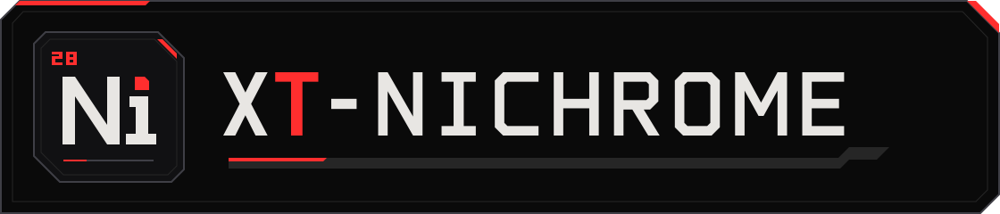
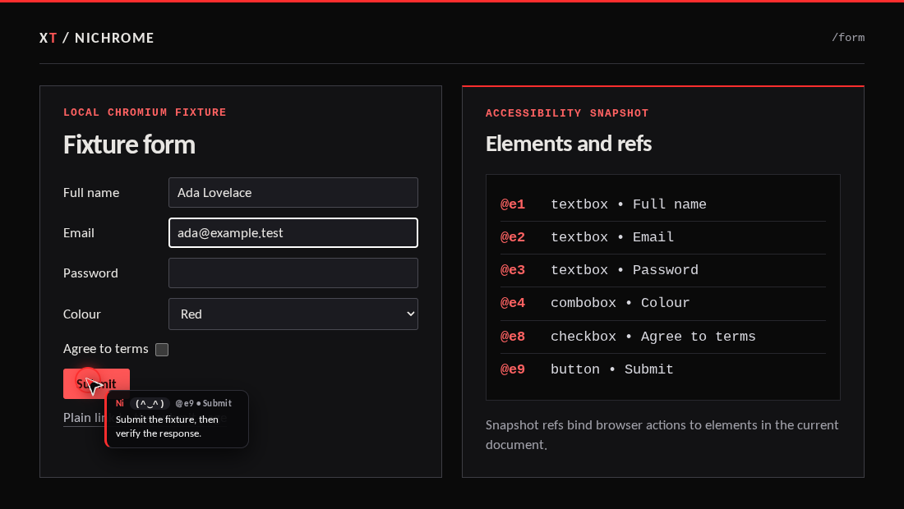
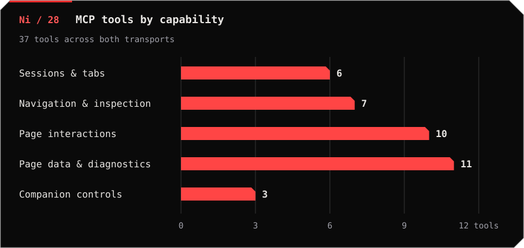
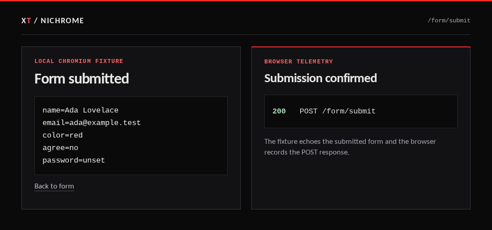
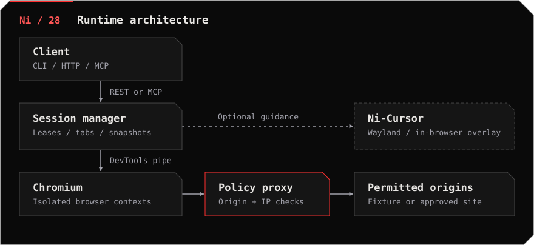
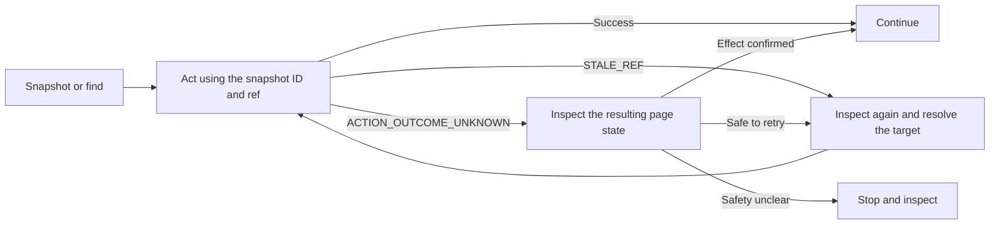
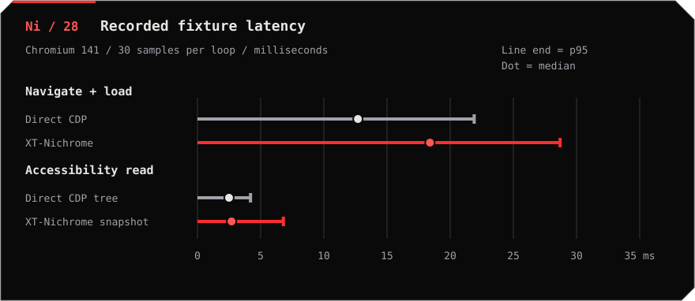
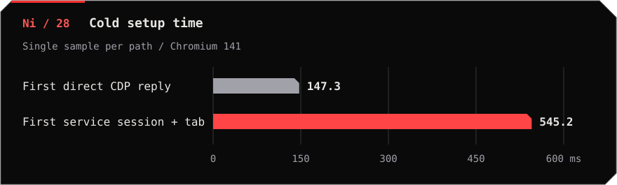
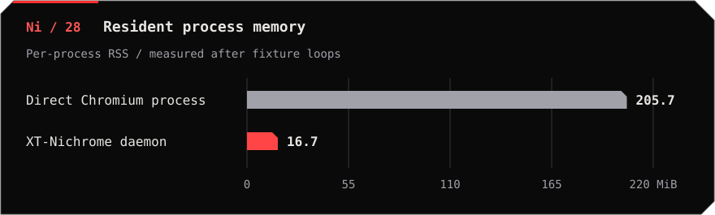

<p align="center">
  
</p>

# XT-Nichrome

XT-Nichrome is a Linux service for driving Chromium from a CLI, REST client, or MCP client. Use it to run browser tests against local fixtures, inspect pages through accessibility snapshots, and capture screenshots or PDFs. The optional **Ni-Cursor** displays a second pointer and guidance on supported Wayland desktops and in browser tabs.

[See it in action](#see-it-in-action) · [Features](#features) · [Quick start](#quick-start) · [Architecture](#architecture) · [MCP and REST](#mcp-and-rest) · [Benchmarks](#testing-and-benchmarks)

| Interface | Use it for | Entry point |
| --- | --- | --- |
| **CLI** | Shell scripts, local smoke tests, and interactive diagnosis | `bin/nichrome-cli` |
| **REST** | Integration with a running service from any HTTP client | `bin/nichrome` · `/v1/*` |
| **MCP over stdio** | A client-managed local process with 37 tools, 4 resources, and 3 prompts | `bin/nichrome-mcp` |
| **MCP over HTTP** | A running daemon shared by REST and MCP clients | `bin/nichrome -mcp-http` · `/mcp` |
| **Ni-Cursor** | Optional visual guidance and selection responses | `bin/nichrome-cursor` |

## See it in action



This capture uses the local form fixture with documentation styling. XT-Nichrome filled the visible fields, read the accessibility references, and drew the Ni-Cursor bubble inside the browser tab.

## Features

| Workflow | What XT-Nichrome provides |
| --- | --- |
| **Run a browser test** | Open a tab, navigate, wait for text, and interact with forms, checkboxes, dropdowns, or file inputs. |
| **Inspect a page** | Read an accessibility snapshot, find elements by role or text, and extract headings, text, and links. |
| **Reproduce a layout issue** | Change viewport size, color scheme, or reduced-motion settings and capture a PNG or PDF. |
| **Diagnose a failed step** | Inspect network responses, console messages, or dialog history. Check the page before repeating a write with an uncertain result. |
| **Keep test state isolated** | Use ephemeral contexts for fresh runs or a locked persistent profile when cookies and storage must survive a restart. |
| **Show where to act** | Point Ni-Cursor at an element in Chromium or display a desktop overlay on supported Wayland compositors. |



Stdio and HTTP expose the same tool inventory, along with four resources and three prompts. [Full MCP tool reference](docs/MCP.md#2-complete-37-tool-inventory)

## Quick start

Run a form smoke test on a loopback fixture. You need Go 1.25 or later, Chromium, Python 3 with FontTools for the daemon's font pack, and `jq` for the shell example. See the installation guide for platform packages and the Chromium build used by the project. [Installation guide](docs/INSTALL.md)

From the repository root, build the binaries and start the fixture server in the first terminal.

```sh
make build cli fixture
make fonts
./bin/fixture-server -listen 127.0.0.1:7789
```

Start the daemon in a second terminal. This command allows exactly the fixture origin and enables loopback access for that test.

```sh
./bin/nichrome -listen 127.0.0.1:7788 \
  -allow http://127.0.0.1:7789 -allow-private
```

Run the workflow in a third terminal. The CLI reads the generated token from the default state directory for authenticated commands.

```bash
(
  set -euo pipefail

  ./bin/nichrome-cli ready -json | jq '{ready, capacity, egress}'

  SID=$(./bin/nichrome-cli new-session -json | jq -er '.sessionId')
  trap './bin/nichrome-cli kill-session -session "$SID" >/dev/null' EXIT

  TID=$(./bin/nichrome-cli new-tab -session "$SID" -json \
    http://127.0.0.1:7789/form | jq -er '.tabId')
  ./bin/nichrome-cli snapshot -session "$SID" -tab "$TID"

  # Find the current textbox and use its own snapshot ID and reference.
  FIELD=$(./bin/nichrome-cli find -session "$SID" -tab "$TID" -json 'Full name')
  FIELD_SNAPSHOT=$(jq -er '.snapshotId' <<< "$FIELD")
  FIELD_REF=$(jq -er '.matches[] | select(.role == "textbox" and .name == "Full name") | .ref | ltrimstr("@")' <<< "$FIELD")
  ./bin/nichrome-cli fill -session "$SID" -tab "$TID" "$FIELD_SNAPSHOT" "$FIELD_REF" 'Ada Lovelace'

  SUBMIT=$(./bin/nichrome-cli find -session "$SID" -tab "$TID" -json 'Submit')
  SUBMIT_SNAPSHOT=$(jq -er '.snapshotId' <<< "$SUBMIT")
  SUBMIT_REF=$(jq -er '.matches[] | select(.role == "button" and .name == "Submit") | .ref | ltrimstr("@")' <<< "$SUBMIT")
  ./bin/nichrome-cli click -session "$SID" -tab "$TID" "$SUBMIT_SNAPSHOT" "$SUBMIT_REF"
  ./bin/nichrome-cli wait -session "$SID" -tab "$TID" 'name=Ada Lovelace'
)
```

The fixture echoes the submitted name. The subshell closes the test session when the workflow ends. Stop the daemon and fixture server with Ctrl-C when finished.



## Architecture



- **Sessions and tabs.** Each server instance owns its session manager. Ephemeral sessions use isolated contexts in a shared Chromium process. Persistent sessions use dedicated Chromium processes and locked profile directories under `<state-dir>/profiles`. Operations on a tab share a bounded queue. Tab creation reserves capacity while Chromium starts the page and releases that slot if setup or the initial navigation fails.
- **Browser control.** Go talks to Chromium over the Chromium DevTools Protocol (CDP) pipe. The browser has no TCP debugging listener. The HTTP daemon's REST and MCP endpoints are separate from that pipe.
- **Network access.** Navigation admission checks the destination origin. Chromium's HTTP, HTTPS, and WebSocket traffic passes through a local proxy that checks policy and resolved IPs. Private and loopback access is blocked by default.
- **Accessibility snapshots.** A snapshot returns readable page structure and handles such as `@e3`. A handle belongs to one snapshot of one tab. When a navigation or document change invalidates it, inspect the page again before acting.

[Internal architecture](docs/ARCHITECTURE.md)

### Action recovery



A fill or click can reach the page before the client sees the result. On `ACTION_OUTCOME_UNKNOWN`, or if the connection drops during a write, check for a receipt, changed field, or another observable effect before retrying. An unknown result on a submit can otherwise turn one submission into two.

## MCP and REST

### MCP transports

Build the stdio server with `make mcp`. Point your MCP client at the absolute path to `bin/nichrome-mcp`. The client starts and owns that process and its sessions. Stdio carries protocol messages on stdout and logs on stderr. To scope browsing to approved origins, set `-allow` to a comma-separated list of those origins, such as the origin of a staging app your team controls.

To share the HTTP daemon's sessions between REST and MCP, add `-mcp-http` to the daemon's existing startup flags. Point the client at `http://127.0.0.1:7788/mcp` for the local setup and provide the same bearer token used by REST. [MCP setup](docs/INSTALL.md) · [Tools, resources, and prompts](docs/MCP.md)

| Task | MCP entry points | REST equivalent |
| --- | --- | --- |
| Check capacity | `browser_ready`, `nichrome://status/ready` | `GET /readyz` |
| Create a session and tab | `browser_open_session`, `browser_open_tab` | `POST /v1/sessions`, `POST /v1/sessions/{id}/tabs` |
| Inspect an accessible page | `browser_snapshot`, `browser_find`, `browser_extract` | `GET …/snapshot`, `POST …/find`, `GET …/extract` |
| Interact with the page | `browser_click`, `browser_fill`, `browser_press_key` | `POST …/actions` |
| Observe or export the result | `browser_telemetry`, `browser_screenshot`, `browser_pdf` | `GET …/telemetry`, `GET …/screenshot`, `GET …/pdf` |
| Display guidance | `companion_cursor_guide`, `companion_cursor_control` | `GET /v1/companion`, `POST /v1/companion` |

In the table, `…` stands for `/v1/sessions/{id}/tabs/{tab}`. [REST routes, payloads, and errors](docs/API.md)

### Ni-Cursor

Run `make cursor` to build the Go companion. The target also builds the native overlay when the GTK 3, layer-shell, Cairo, and PangoCairo development dependencies are detected. For a standalone desktop overlay that reacts to the Wayland primary selection, start it from your desktop session.

```sh
./bin/nichrome-cursor -listen 127.0.0.1:7798 -watch-selection -auto-hide 6s
```

Selection watching requires `wl-paste`. Use the installation guide to check native dependencies and configure Hyprland shortcuts. [Ni-Cursor setup](docs/INSTALL.md#4-optional-wayland--hyprland-2nd-companion-cursor-ni-cursor)

## Operations

| Setting | Default | What it controls |
| --- | --- | --- |
| HTTP listener | `127.0.0.1:7788` | REST and optional Streamable HTTP MCP |
| State directory | `~/.local/share/xt-nichrome` | Profiles, generated bearer token, and transient state |
| Egress | HTTP daemon starts with an empty allowlist. Stdio defaults to public HTTP and HTTPS when no allowlist is configured. | Use `-allow` for explicit origins. Stdio also supports `-strict-allow` to suppress its default public access. |
| Ephemeral sessions | 4 | `-max-ephemeral` |
| Persistent sessions | 2 | `-max-persistent` and one active lease per profile |
| Tabs per session | 4 | `-max-tabs` |
| Queued operations per tab | 8 | Bound on pending work for a tab |
| Idle session eviction | 10 minutes | `-idle-timeout` · `0` disables eviction |

`GET /healthz` checks process liveness. `GET /readyz` reports counts, limits, and egress denials. It returns HTTP 503 when combined session capacity is exhausted. An individual pool can fill before combined capacity is reached. Both endpoints and the CLI's `health` and `ready` commands work without a bearer token.

All `/v1/*` routes and the optional `/mcp` endpoint require a bearer token. On first use, the daemon creates `<state-dir>/token` with mode `0600`. Concurrent starts that share the token path read the same persisted credential. If you use a non-default state directory, set `XT_NICHROME_STATE` for both the daemon and CLI or set each command's `-state-dir`. The daemon also accepts `-token-file`. Preserve the token file's access restrictions when provisioning one yourself. Keep the HTTP listener on loopback for local use and use TLS for remote transport.

For a persistent test session, open one with a dedicated profile ID. Use the same ID to reopen the profile after closing the session. Closing the session releases its lock and preserves the profile on disk.

```sh
./bin/nichrome-cli new-session -mode persistent -profile staging-qa -json
# Use the returned sessionId to close the session when finished.
./bin/nichrome-cli kill-session -session SESSION_ID
```

The REST JSON decoder rejects unknown fields, duplicate keys, and trailing data. The default request-body limit is 1 MiB. The endpoint reference documents the expected body and response for each verb. [REST API reference](docs/API.md)

### Troubleshooting

| Symptom | What to check |
| --- | --- |
| Daemon exits before listening | Check stderr, run `make fonts` if the pack is missing, and pass `-browser /absolute/path/to/chrome` if Chromium discovery fails. |
| Status works but protected commands return `UNAUTHORIZED` | Confirm the CLI and daemon use the same token source, and check for an overriding `XT_NICHROME_TOKEN` in the CLI environment. |
| Fixture navigation returns `POLICY_BLOCKED` | Confirm the exact scheme, host and port in `-allow` and use `-allow-private` for the loopback fixture. |
| `CAPACITY` or `BUSY_PROFILE` | Inspect `ready` and `sessions`. Release unused sessions. An already leased persistent profile can be reopened after its owner closes it. |
| Snapshot output is truncated | Check `truncated` and `refCount` in JSON output. Increase `-max-chars` or `-max-refs` within the API limits when needed. |
| Native overlay executable is missing after `make cursor` | Run `pkg-config --exists gtk+-3.0 gtk-layer-shell-0 cairo pangocairo` and install missing development packages. |

## Testing and benchmarks

| Command | What it runs | Requirements |
| --- | --- | --- |
| `make fmt vet` | Go formatting check and static analysis | Go |
| `make unit` | Command and internal package tests | Go, loopback sockets, Chromium for the browser-backed MCP test |
| `make race` | The same package tests with the Go race detector | Go with race detector support, loopback sockets, Chromium for the browser-backed MCP test |
| `make e2e` | End-to-end tests against a real Chromium browser | Chromium, daemon font pack, loopback sockets |
| `make bench` | Direct CDP and daemon fixture measurements | Chromium, daemon font pack, loopback sockets |

### Navigation and accessibility



| Operation | Direct CDP median / p95 | XT-Nichrome median / p95 |
| --- | ---: | ---: |
| Navigate and load | 13.8 / 18.8 ms | 20.6 / 27.6 ms |
| Read accessibility data | 2.5 / 5.4 ms | 2.8 / 6.4 ms |

The accessibility timings cover different outputs. Direct CDP fetches the raw accessibility tree. The service renders a snapshot with element references.

### Cold setup



The direct run measures Chromium launch through the first successful DevTools reply. The service run starts after the daemon is ready and measures Chromium startup plus session and tab creation. Each value comes from one timed setup.

### Resident process memory



The daemon sample covers the Go process alone. Chromium and its child processes run separately, so these readings describe individual processes.

These figures come from one `make bench` run with Chromium 141 on November 20, 2026. The navigation and accessibility timings use 30 samples per loop. Run `make bench` to measure your own host. [Benchmark source](bench/bench_test.go)

## Repository map

| Path | Responsibility |
| --- | --- |
| [`cmd/`](cmd/) | Daemon, MCP stdio server, CLI, companion, and fixture binaries |
| [`internal/api/`](internal/api/) · [`internal/mcpserver/`](internal/mcpserver/) | REST and MCP adapters |
| [`internal/sessions/`](internal/sessions/) · [`internal/snapshots/`](internal/snapshots/) · [`internal/profiles/`](internal/profiles/) | Leases, tab queues, accessibility handles, and profile storage |
| [`internal/browser/`](internal/browser/) · [`internal/cdp/`](internal/cdp/) | Chromium process and DevTools transport |
| [`internal/policy/`](internal/policy/) · [`internal/egress/`](internal/egress/) | Origin policy and outbound proxy |
| [`internal/companion/`](internal/companion/) | Ni-Cursor overlay control and selection handling |
| [`tests/`](tests/) · [`bench/`](bench/) | Browser integration tests and fixture benchmarks |
| [`docs/`](docs/) · [`assets/`](assets/) | Reference docs, diagrams, and the Ni-28 brand assets |
